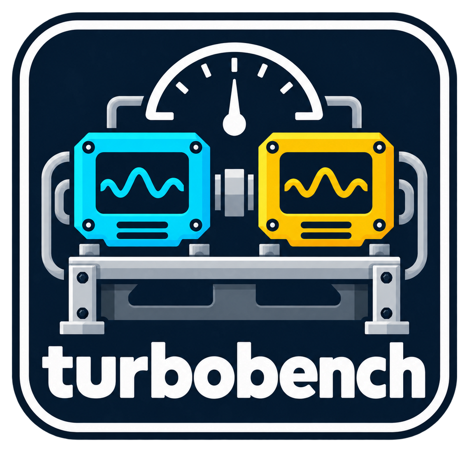
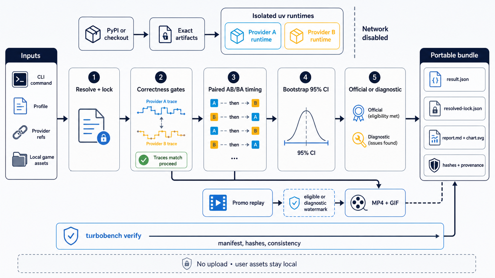

<p align="center">
  
  <br />
  <!-- repo-tagline:start -->
  <strong>⚖️ Matched environments, measured fairly ⚖️</strong>
  <!-- repo-tagline:end -->
</p>

<p align="center">
  <a href="https://github.com/tsilva/turbobench/actions/workflows/ci.yml"></a>
  <a href="https://pypi.org/project/turbobench-cli/"></a>
  <a href="https://github.com/tsilva/turbobench/blob/main/pyproject.toml"></a>
  <a href="https://github.com/tsilva/turbobench/blob/main/LICENSE"></a>
</p>

`turbobench` checks whether reinforcement-learning environment providers
behave the same and measures their performance under matched workloads.
It records exact versions, hashes, and verification evidence in local bundles.

## Quickstart

Requires Python 3.11+, uv, FFmpeg, and FFprobe. Isolated provider environments
default to CPython 3.14.

Install [turbobench-cli 2.0.11](https://pypi.org/project/turbobench-cli/2.0.11/):

```bash
uv tool install turbobench-cli==2.0.11
```

Choose a workload and check the host:

```bash
turbobench profiles list
turbobench providers list
turbobench doctor vizdoom/basic-v1
```

The host check reports missing tools or assets before you run parity or
benchmark measurements. Use the [usage guide](https://github.com/tsilva/turbobench/blob/main/docs/usage.md)
for a matched comparison and how to verify the output bundle. Quick runs are
diagnostic.

- [Certify provider parity](https://github.com/tsilva/turbobench/blob/main/docs/parity.md)
- [Run benchmarks and export charts or videos](https://github.com/tsilva/turbobench/blob/main/docs/comparison-workflow.md)
- [Measurement rules and prior timing correction](https://github.com/tsilva/turbobench/blob/main/docs/usage.md#measurement-and-validity)

Provide any required game assets locally. Results stay on disk until you
choose to share them.

## Architecture



## License

[MIT License](https://github.com/tsilva/turbobench/blob/main/LICENSE).
